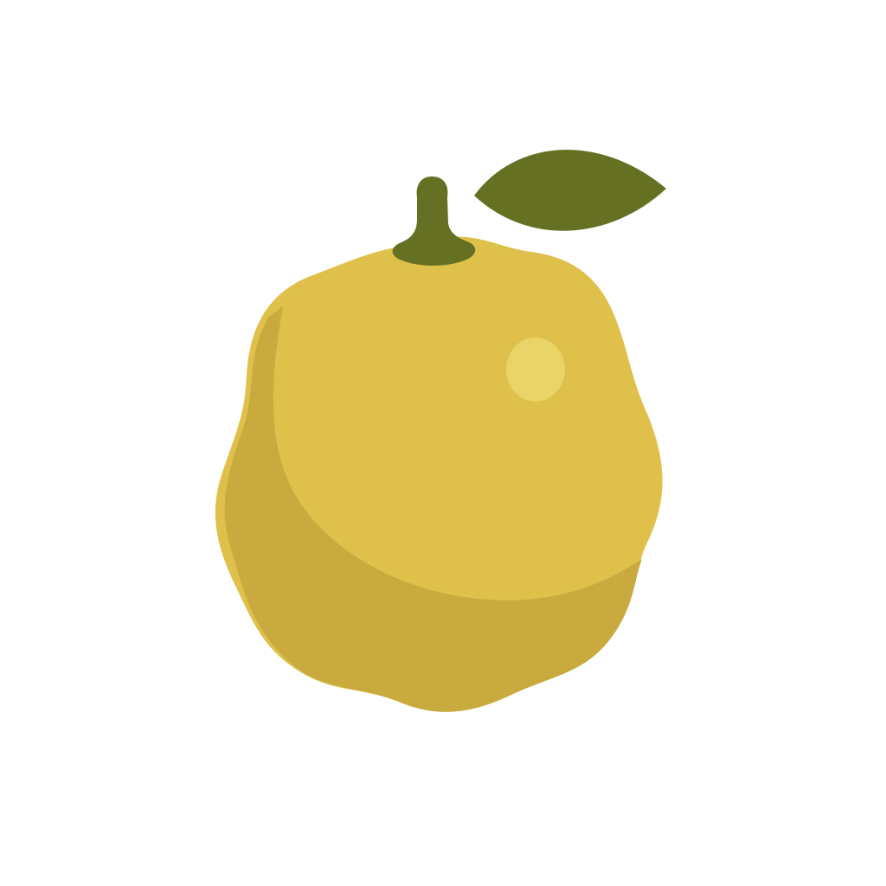
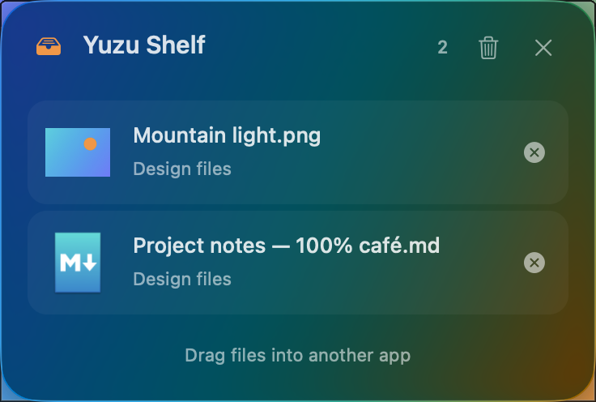

# Yuzu Converter



File conversion and useful file actions from your Mac’s menu bar. Hold a key while dragging a file, choose a destination on the wheel, and drop.

**v0.5.1 adds a configurable Finder shortcut and keeps shelves when you close them.** Select files in Finder and press **Control+C**, or record your own combination in Settings. **Show Shelf** restores closed collections for the current app session. The compact panel keeps its previews, parent-folder labels, and layout that grows through five rows. Native Liquid Glass is used on macOS 26+; earlier systems use a translucent material, and Reduce Transparency uses an opaque surface.



FFmpeg and FFprobe provide video conversion out of the box. Convert MP4, MOV, MKV, WebM, AVI, and WMV, create animated GIFs, and extract MP3 audio without installing Homebrew. The five-tab Settings screen and per-format profiles remain available on Apple Silicon and Intel. File tools remain outside the scope.

## Download

Requires **macOS 13 or later**, on Apple Silicon or Intel.

- [Download for Apple Silicon](https://github.com/StPashik/Yuzu-converter/releases/download/v0.5.1/Yuzu-Converter-0.5.1-arm64.zip)

- [Download for Intel](https://github.com/StPashik/Yuzu-converter/releases/download/v0.5.1/Yuzu-Converter-0.5.1-x64.zip)

Intel users on 0.4.0 can update directly through **Check for Updates…**. Version 0.4.1 was Apple Silicon only.

This software uses FFmpeg under LGPL 2.1 or later. [Complete corresponding media source](https://github.com/StPashik/Yuzu-converter/releases/download/v0.5.1/Yuzu-FFmpeg-Sources-0.5.1.tar.xz) is supplied with the release.

Unzip the download, move **Yuzu Converter.app** to Applications, and launch it. The app appears in the menu bar. Builds use an ad hoc signature, without Developer ID or notarization, so Gatekeeper may block the first launch.

See the [quick start](docs/Quick-start.md) for first installation, permissions, and npm options. For subsequent versions, use **Check for Updates…** when you choose.

## Use it

1. Start dragging a file or a group of files.
2. Hold **Shift** for conversion or **Control** for Actions.
3. Drop onto a wheel sector. Press **Escape** to cancel, or hold the other modifier to switch wheels.

Open **Settings… → General** to choose independent shortcut combinations, Glass/Solid style, feedback, login behavior, Terminal/iTerm2, or whether files join an existing shelf. **Formats** stores output defaults, **Compatibility** shows current routes, and **Folders** manages remembered access. Converted files stay beside their originals under an available name. See the [Settings guide](docs/Settings.md) for supported options and limits.

Choose the interface language in Settings: **English** (default), **Russian**, **German**, **French**, or **Spanish**. App-owned UI updates live; some system dialogs use the new language after an app restart. Your Mac's global language is unchanged. Technical converter diagnostics, project documentation, code comments, and releases remain English.

Actions include **AirDrop**, **Float**, **Copy Files**, **Move**, **Copy Path**, **Open Terminal**, and **Compress to ZIP**. Float keeps file references for the current session. **Show Shelf** restores retained shelves or an empty drop area below the menu bar icon. Close Shelf and Escape hide a shelf while keeping its files available for reopening; Remove and Clear Shelf explicitly remove references. Exiting Yuzu ends the session. Original files stay in place. Compress to ZIP creates one archive beside the first selected item and preserves the originals.

Select files in Finder and press **⌃C** to add them to the shelf. Record a different combination directly in **Settings → General → Actions**, or press Delete while recording to disable it. The shortcut is active only in Finder; first use can request Finder and folder access. It preserves your clipboard. See the [quick start](docs/Quick-start.md#keep-files-on-the-shelf).

## Keep the app up to date

Choose **Check for Updates…** from the menu bar or **Settings → About**. When an update is available, Sparkle shows the new version and lets you download and install it. Checks are manual; installation waits for active file jobs to finish and then restarts Yuzu after your confirmation. Release publication leaves your installed copy alone. See the [update guide](docs/Updates.md) for first installation, signing, and release maintenance.

Version 0.6.0 adds Convert/Actions menus for selected shelf rows and a shared-style Operations panel with cancellation and result history. The [shelf workflow](docs/Shelf-workflow.md) explains output and cancellation; the [CI guide](docs/CI.md) describes verified FFmpeg reuse.

See the [shelf design](docs/Shelf-design.md) and [wheel design notes](docs/Wheel-design.md) for appearance, ownership, and native AppKit previews.

## Format support

| Area | Implemented support |
| --- | --- |
| Images and PDF | System image readers/writers; every PDF page to JPG/PNG at 300 DPI; existing PDF text to TXT/MD |
| Audio and video | Native WAV/AIFF/M4A and MP4/MOV, plus bundled FFmpeg video, GIF, MP3/FLAC/Opus/WMA routes |
| Documents and EPUB | Text and rich-text DOCX, PDF/HTML/image export, and simple text-based EPUB reflow |
| Spreadsheets | CSV/TSV/XLSX/ODS, all sheets, values as strings; text-based PDF output |
| Subtitles and archives | SRT/VTT/TXT and ZIP/TAR/TAR.GZ; RAR input where system libarchive supports it |

The [conversion matrix](docs/Conversion-matrix.md) describes the actual routes and remaining targets. Yuzu does not support PAGES, PPT/PPTX, legacy XLS, textClipping, OCR, editable Office reconstruction from PDF. Complex layouts, spreadsheet formulas/styles, and EPUB assets are not preserved. Image writers and media decoders depend on macOS.

FFmpeg and FFprobe are included for both architectures; no Homebrew setup is required. See [video formats, source, and licenses](docs/Bundled-media.md). LibreOffice remains optional in unsandboxed developer runs. Cross-volume folder moves are refused; file moves use an original size/mtime check, without content hashing. Oversized PDF pages are rejected rather than rendered below 300 DPI.

## Install with npm

Node.js 20.11+ and a compatible npm version are required. For npm 12, allow this exact release URL and its installation script for this command:

```sh
YUZU_PACKAGE_URL="https://github.com/StPashik/Yuzu-converter/releases/download/v0.5.1/stpashik-yuzu-converter-0.5.1.tgz"
npm install -g --allow-remote=all --allow-scripts="$YUZU_PACKAGE_URL" "$YUZU_PACKAGE_URL"
yuzu-converter
```

Older npm versions can use `npm install -g "$YUZU_PACKAGE_URL"` without those npm 12 options. No global permission settings need to change. The installer checks a pinned SHA-256 and installs the app in `~/Applications`; the package is distributed through GitHub Releases, not the npm registry. The app itself runs without Node.

## Development

Use macOS, Xcode/Swift 5.9+, and Node/npm. Build release archives with **Xcode 26 or later** to include native Liquid Glass; older developer toolchains compile the native material fallback:

```sh
npm ci --ignore-scripts
npm test
swift test --scratch-path .build/verification
swift run --scratch-path .build/development YuzuApp
```

Build the pinned media engines and both architecture-specific app archives, then pin their final checksums and package the installer. Build prerequisites and LGPL source obligations are in the [media guide](docs/Bundled-media.md):

```sh
python3 scripts/build-media.py arm64
python3 scripts/build-media.py x64
bash scripts/build-app.sh arm64
bash scripts/build-app.sh x64
node scripts/prepare-npm.mjs dist
node scripts/prepare-updates.mjs dist
npm pack --pack-destination dist
python3 scripts/package-media-sources.py
```

Rebuilding an app archive requires rerunning `prepare-npm` and `npm pack`. Developer tool overrides are `YUZU_FFMPEG`, `YUZU_FFPROBE`, and `YUZU_LIBREOFFICE`; they do not extend the packaged Sandbox app. Read the [developer guide](docs/Developer-guide.md) for entry points, file-access ownership, cancellation, localization, and the release checklist.

## Project and verification

The code was written from scratch after [Tangerine research with REA](docs/TangerineResearch.md), including [five observed Settings pages](docs/Tangerine-settings.md). Observed UI and static field names remain separate from unknown proprietary defaults. Compress to ZIP is a separate owner-requested feature. The owner authorized the Yuzu Mac App icons and wheel design reference; no old engines, settings, caches, source modules, or Git history were carried over. See [component notices](THIRD_PARTY_NOTICES.md). Normal releases are stable GitHub Latest releases; signing limitations are documented separately. Contributors and maintainers follow the [PR/release workflow](docs/Releasing.md).

The wheel regression test exercises real WindowServer hit-testing before a drag is confirmed: it fails with the old fully transparent window and passes with the corrected background. Shelf tests cover placement, drag callbacks, source preservation, material/selection changes, and five-language layouts. Fresh release checks are recorded in [validation](docs/Validation.md); [app QA](docs/QA.md) and [installer QA](docs/NpmQA.md) retain historical review results. Physical Finder/Powerbox, AirDrop/Terminal, VoiceOver, shelf drag-out, external-file Sandbox Quick Look, macOS 13, and macOS 26 Intel appearance remain unverified.
