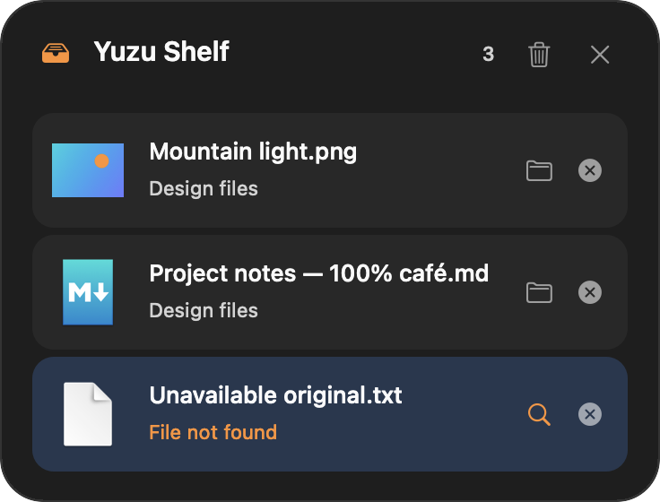

# Retry and shelf reference recovery

## Retry unfinished work

A failed row in **Operations** shows a reason, a recovery suggestion, and **Details…**. Fix the reported issue, then choose **Retry**. The remaining inputs join the end of the serial queue with the original output settings. The displayed counter starts again for that attempt. Earlier output files and their recorded URLs are preserved, with no re-encoding or duplicate publication for completed inputs.

For example, if three images were being converted individually and the second file became unavailable, the first output is kept. Retry processes the second and third inputs after their issue is resolved. A combined image PDF and ZIP are single atomic results; if no result was published, their whole input group is retried.

Retry retains the pending source/destination grants during the running session. **Clear Finished** removes the failure and releases those references. Success/cancellation releases its request, and success rows still expire after one second. Closing Operations keeps work and retryable failures; exiting Yuzu ends the session. There is no automatic retry, restart recovery, or rollback that removes already created results.

**Details…** shows the original technical diagnostic. **Copy Details** includes the complete text even when the dialog preview is shortened. Native system error descriptions may follow the system language; Yuzu's diagnostic headings and converter messages are English. Permissions, missing files/drives, space, output-name conflicts, damaged input and image-download failures have localized recovery suggestions. A permanent format/codec limitation requires a new supported request, rather than repeated retries.

A copy can be published before a cross-volume Move fails to remove its source. That publication is not repeated. If no unfinished inputs remain, Retry is unavailable and the row asks you to inspect the source and created copies before removing anything. This is deliberately separate from a confirmed completed move.

A valid prepared virtual image is retained after encoding fails. Retry reuses those bytes and the exact chosen Save As path; it does not consume a file promise again or replace an existing output. Clear Finished or completion releases the private temporary input. If an image promise failed before producing usable bytes, drag the image again. URL retries may download it again with the existing limits. See [Virtual image drops](Virtual-image-drops.md).

## Keep shelf references usable

Completed **Move** Actions update affected references on every Yuzu shelf, including hidden collections. Moving a real folder also updates references to its children. Duplicate paths merge while selected references remain selected. Moving a symlink changes the link reference, without redirecting references to its target's children. Source files and copies are not deleted by shelf repair.

Waiting requests and failed requests retained for Retry follow completed Yuzu moves as well. A beside-source output follows the moved source; an explicitly selected folder follows a completed move of that folder. Virtual-image Save As keeps its exact chosen output path. Destination grants stay retained by the references/jobs that need them after the Move row expires.

When a shelf is opened, changed, or visible, Yuzu checks availability off the main thread. Visible shelves poll every two seconds; closing stops polling while preserving the collection. Missing files show **File not found**; unreadable files show **Access is required**. Their folder button becomes a search button labeled **Locate Original…**. Known unavailable rows do not advertise a drag source.

Choose the search button and select the file or folder at its new location. This replaces only the shelf reference, retains the selected item's access grant, and refreshes the preview. Cancelling the picker changes nothing. Selecting the same path can renew a reference's grant; POSIX permissions still need to allow reading.

External Finder moves are detected as availability changes; Yuzu does not search the disk or automatically follow arbitrary external paths. Shelf repair does not rewrite an already failed request's source path; submit that externally relocated file again. Completed moves performed by Yuzu update retained requests directly. Session-only shelf retention and the existing five-language interface remain unchanged. No conversion/Actions menus are added to the shelf.

## Verification boundary

These images are native automated renders using the opaque accessibility fallback. Fixtures verify partial conversion/Move retries, normalized folder children, pending/failed jobs following known moves, destination ownership, one-time promises, temporary-file cleanup, selection/deduplication, missing/access-denied states, visible polling, and five-language layouts. A regression reproduced the only-error-window closing during Retry; one coherent row-list publication corrects it.

Physical Finder/browser/Powerbox/Sandbox interoperability, VoiceOver, macOS 13, other-Mac appearance, and cross-volume device behavior remain deferred/unverified. Signed own-container Sandbox checks are separate release evidence, not proof of those physical workflows.
