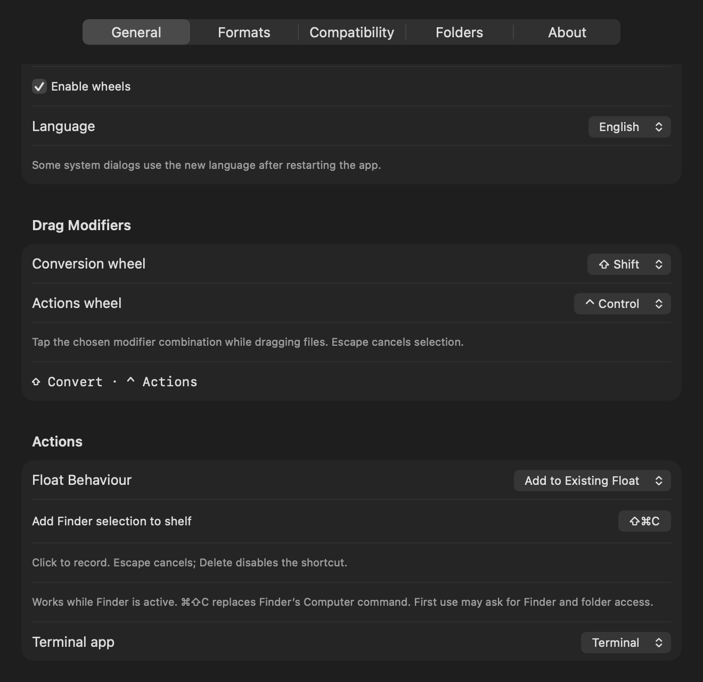
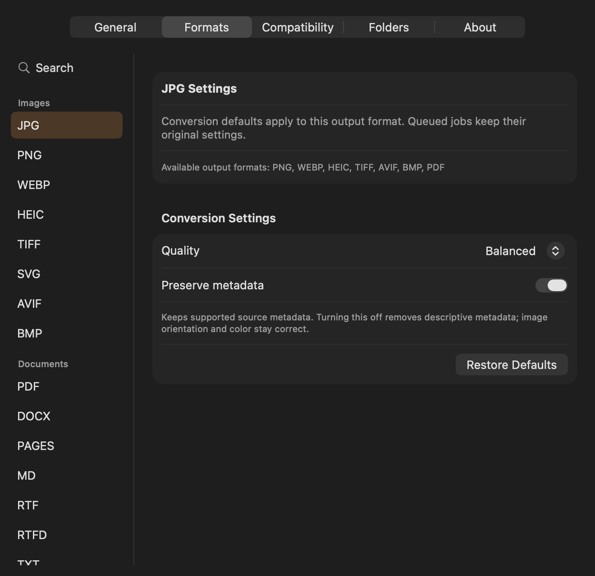

# Settings and conversion profiles

Open **Settings…** from the Yuzu menu bar. The five tabs follow the organization observed in Tangerine, using Yuzu's own implementation and native macOS controls. The window can grow, and long pages scroll. English, Russian, German, French, and Spanish remain available.

## General

- **Style:** Glass uses a masked macOS backdrop; Solid uses an opaque surface. Reduce Transparency also selects an opaque surface. The rounded Yuzu wheel geometry and orange selection remain.
- **Launch at login:** registration belongs to macOS. If approval is required, use **Open Login Items**, approve Yuzu there, and return to Settings. The checkbox reflects the system state; installation never enables it automatically.
- **Sound and haptic feedback:** entering a different wheel sector plays the system Tink sound and requests alignment feedback. Repeated updates within one sector are silent. Haptics require compatible hardware.
- **Enable wheels:** pauses both wheels without removing their shortcut descriptions.
- **Language:** changes app-owned text immediately. Some system dialogs use the new language after restarting Yuzu.
- **Drag Modifiers:** choose a nonempty combination of Shift, Control, Option, and Command for each wheel. Choosing the other wheel's combination swaps the two, keeping both reachable. Existing swapped Shift/Control preferences migrate.
- **Float Behaviour:** create a new shelf, or add to the existing shelf.
- **Add Finder selection to shelf:** click the shortcut field and press a new combination inside Yuzu. The default is **⌘⇧C**; Escape cancels recording and Delete disables it. Use a letter, number, Space, or F-key with at least two modifiers including Command or Control. Unavailable registrations leave the old choice intact. The saved key follows its physical keyboard position; its label reflects the current layout.
- **Terminal app:** use Terminal or iTerm2. Selecting iTerm2 does not install it; a missing app produces a useful error.

Escape cancels the current selection until the mouse button is released. The wheels still require actual file URLs from AppKit dragging; no Accessibility or Screen Recording permission is required by Yuzu.

The shelf shortcut works only while Finder is active. **⌘⇧C replaces Finder's Computer command while Yuzu handles that chord**; choose a different combination if you use that Finder command. First use can request permission to read Finder's selection under **System Settings → Privacy & Security → Automation**. If a selected file is outside Yuzu's Sandbox access, the usual folder picker requests its actual parent and remembers your approval. The existing Folders page can revoke that future access. Refusing or cancelling does not add a partially authorized batch. Keyboard recording and these permission messages support all five app languages. System approval dialogs may need an app restart to adopt a newly selected language.

This development render is scrolled to Actions. Actual Finder/Automation/Powerbox approval remains a separate unverified check.

Apple documents the [Finder-targeted Sandbox exception](https://developer.apple.com/library/archive/documentation/Miscellaneous/Reference/EntitlementKeyReference/Chapters/AppSandboxTemporaryExceptionEntitlements.html) and [user-selected file access](https://developer.apple.com/documentation/security/accessing-files-from-the-macos-app-sandbox). Finder's installed scripting dictionary exposes no public selection access group; the app's exception is limited to Finder, and its shipped query only reads selected aliases. No private preference files or synthetic keystrokes are used to configure the shortcut.

## Formats

Search the sidebar and select an **output format**. Its defaults apply to future jobs that produce that format. Yuzu captures a value copy when a job is queued, so changing preferences cannot alter work already queued or running. **Restore Defaults** affects only the selected format.

This is a native development render with an inactive window. Backend availability and login/update controls differ from the packaged app; it is not a physical Sandbox check.

| Output | Working settings |
| --- | --- |
| JPG, HEIC, WebP, AVIF | Compact/Balanced/High quality; supported descriptive metadata policy |
| PNG, TIFF, BMP | Supported descriptive metadata policy; no lossy-quality selector |
| M4A | Quality, automatic or explicit audio bitrate, metadata policy |
| WAV, AIFF | Match-source PCM depth or explicit 16/24/32-bit integer and 32-bit float |
| MP4, MOV, MKV, WebM, AVI, WMV | Quality preset, maximum displayed video height, metadata policy |
| ZIP, TAR.GZ | Fast/Balanced/Maximum compression |
| EPUB | Reflowable EPUB 2 or EPUB 3 |
| MP3, FLAC, Opus, WMA | Bundled FFmpeg; applicable quality/bitrate and descriptive metadata policy |
| Animated GIF | Frame rate and maximum width; silent output, using bundled FFmpeg |

[Bundled media](Bundled-media.md) describes the exact video codecs and stream-selection limits. OGG encoding still requires a developer-installed Vorbis encoder; no unsupported encoder is implied by the sidebar.

A format's presence in the sidebar is not a support claim. Unavailable outputs and original-page EPUB/PDF-to-Office layouts are visibly explained. They do not become enabled conversions. The [conversion matrix](Conversion-matrix.md) preserves the remaining requirements.

The metadata policy covers supported descriptive tags, not every binary property. Images are re-encoded when metadata is removed, with orientation applied to the pixels and color retained. Generated PDF/document images keep their required 300-DPI information. Native metadata-off video uses a fresh media composition that excludes source container metadata, timed-metadata, timecode, and chapter-associated tracks. PCM metadata removal is unavailable. FFmpeg removal also disables per-stream metadata and chapters. Keep originals when metadata matters.

**Yuzu's encoding choices** are explicit implementation decisions, not recovered Tangerine numeric defaults:

| Setting | Values |
| --- | --- |
| Image quality | Compact 0.65; Balanced 0.9; High 1.0 |
| Automatic compressed-audio bitrate | 96 / 192 / 256 kbit/s according to quality |
| Native video | macOS Low / Medium / Highest quality presets |
| FFmpeg MPEG-4/WMV video | Quantizer 8 / 3 / 1 |
| FFmpeg VP9/WebM | CRF 40 / 30 / 20, YUV 4:2:0 pixels |
| Archive compression | Levels 1 / 6 / 9 |
| GIF automatic settings | 15 frames/s, maximum width 960 pixels |
| EPUB default | Version 2 |

An explicit audio bitrate overrides its quality preset. Native video Balanced now uses Medium rather than the earlier fixed Highest preset; select High for the highest system preset. A height/width cap never deliberately enlarges a smaller source. System presets can also affect resolution and codec characteristics.

Match-source PCM accepts supported 16/24/32-bit integer and 32-bit float sources. Lossy sources use a documented 16-bit fallback. Unsupported source depths, including 64-bit float, produce an error rather than silently lose precision. Resizing video with multiple video tracks is refused. Native video export preserves disabled tracks and applies actual audio gain, including mute, through an explicit mix. Unsupported source playback gains outside 0…1 are refused without clamping.

## Compatibility

The matrices come from Yuzu's current routing and encoder checks:

- **✓ Available:** the format-level route exists with the current backend.
- **◐ Depends on the file:** a native media route needs an actual compatible asset.
- **— Unavailable:** that pair is not currently offered.

Only current output columns are displayed. See the linked matrix for the full target inventory and missing routes. These symbols do not guarantee that every damaged file, media profile, or macOS version works.

## Folders

**Add Folder…** opens macOS's folder picker and remembers Yuzu's own security-scoped bookmark. A folder can cover descendants after canonical containment checks. Results still go beside each original, rather than into the granted ancestor itself.

The minus button forgets future access without deleting files or interrupting active jobs. Yuzu requests access again when needed. Folder paths and grants from Tangerine are never imported. Physical Sandbox grant recovery and descendant-bookmark derivation remain unverified; automated containment checks do not replace that gate.

## About

About shows the app icon/version, documentation, releases, and the shared **Check for Updates…** control. Updates stay manual and wait for queued file operations before restarting. Yuzu adds no trial counter, account, purchase, or restore-purchase interface.

## Developer notes and evidence

[Settings.swift](../Sources/YuzuApp/Settings.swift) owns preferences and migration; [SettingsView.swift](../Sources/YuzuApp/SettingsView.swift) owns the five-tab UI. [ConversionOptions.swift](../Sources/YuzuCore/ConversionOptions.swift) validates profiles at the encoder boundary. The job queue captures those values. [AccessStore.swift](../Sources/YuzuApp/AccessStore.swift) and [SystemPreferences.swift](../Sources/YuzuApp/SystemPreferences.swift) retain their respective folder and system-registration responsibilities.

[Tangerine-settings.md](Tangerine-settings.md) separates the five observed pages and static field names from unverified proprietary behavior. No Tangerine source, artwork, sounds, binaries, grants, or settings are distributed. Native render tests cover the five tabs, five languages, both appearances, and the relevant format editors; [Validation.md](Validation.md) records actual run results and open physical checks.
