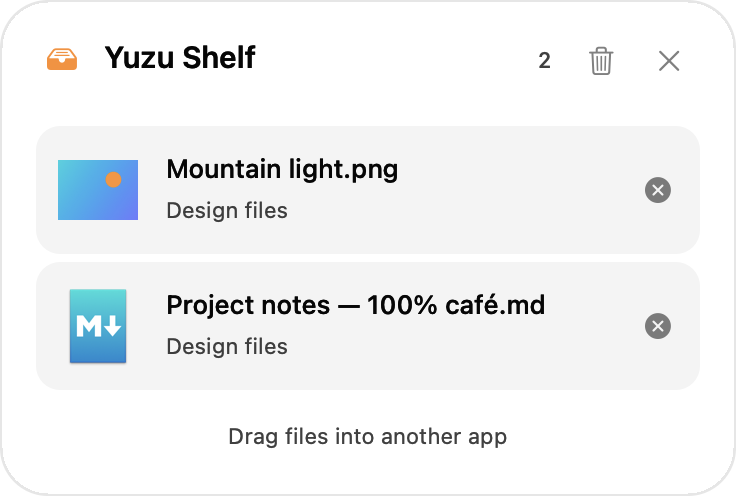

# Menu bar shelf

The owner requested a smaller, more polished shelf with transparency and a visual connection to the Yuzu menu bar icon. This is a Yuzu design change, not a claim of Tangerine behavior.

Choose **Show Shelf** in the Yuzu menu, or use **Float** in Actions. The panel opens below the current menu bar button, follows its window/display changes, and stays inside the display's visible area. One file uses a 368 × 180-point panel. Height grows through five rows, then the list scrolls. Additional shelves retain the existing Float preference and receive a small cascade offset.

Drop files directly on the panel, or add them through Float. Each row has a lazy Quick Look preview with system-icon fallback, the filename, its parent folder, and a remove button. Drag rows into another app using normal file-URL copy dragging. Delete removes selected references, and Clear Shelf removes every reference. Close Shelf or Escape hides the panel while retaining its contents and file grants; Show Shelf reopens all retained shelves. The owner requested this retention only within the current app session, ending when Yuzu exits. None of these operations deletes or moves originals. The panel remains visible while Finder or another destination app is active.

## Materials and accessibility

Release archives built with Xcode 26 include Apple's [NSGlassEffectView](https://developer.apple.com/documentation/appkit/nsglasseffectview) for macOS 26+. Earlier macOS versions use the native active popover material behind the window. Older Xcode 16 developer/Intel CI builds compile that fallback without requiring newer SDK symbols. The minimum runtime stays macOS 13.

Reduce Transparency replaces the translucent material with an opaque surface and reacts to changes while the shelf is open. Existing file references, selection, and drag handlers survive a material change. There are no custom opening animations. All controls, hints, and file-removal labels follow the existing five-language selection; system colors and AppKit controls supply appearance and accessibility behavior.

This is a real WindowServer capture on macOS 26.6.2 / Apple Silicon. The isolated preview compiled the production `Shelf.swift` verbatim and used its own sample files, resources, app identity, and opaque gradient backdrop. The captured rectangle was checked against both windows owned by that preview PID, so it contains no unrelated app content. The owner's installed app was not replaced or restarted. REA could not bind this fixture window; the system's selected-region screenshot utility supplied the image.

The opaque image comes from the actual Reduce Transparency surface. Offscreen bitmap snapshots do not reproduce WindowServer's dynamic glass/vibrancy; layout snapshots deliberately use this opaque mode rather than treating blank material masks as successful UI renders.

## Implementation and verification

`ShelfController` in [Shelf.swift](../Sources/YuzuApp/Shelf.swift) owns window geometry, reference/grant lifetime, and thumbnail requests. `ShelfView` owns AppKit layout and destination callbacks; the table remains the drag source. A per-request UUID rejects late previews after a path is removed/re-added, and the source lease remains alive through thumbnail completion. Closing cancels pending requests while retaining the collection; reopening reloads the table and requests missing previews. `ActionController` keeps nonempty closed shelves and presents every retained collection from the menu, preventing independent hidden shelves from becoming unreachable. Removing references cancels their pending work and never touches source file contents.

Five shelf regressions cover primary/secondary/small-screen placement, capped height, duplicate/file-only/copy-only drops and drag updates, URL drag-out, source preservation, material replacement without losing the live table, and light/dark layouts for all five languages. The close/reopen regression exercises the real close button, Escape, Show Shelf, both Float preferences, the same retained window, a live source lease, and multiple independent closed collections. Active translucent selection keeps normal label colors; its regression failed in both appearances before the row-style correction. Snapshot checks reject blank images. These are automated fixture checks, not physical Finder/Powerbox or VoiceOver verification. Native macOS 13 and macOS 26 Intel appearance, a full Sandbox Quick Look workflow with external files, and physical screen/menu-bar rearrangement remain unverified.
