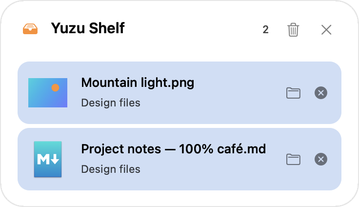
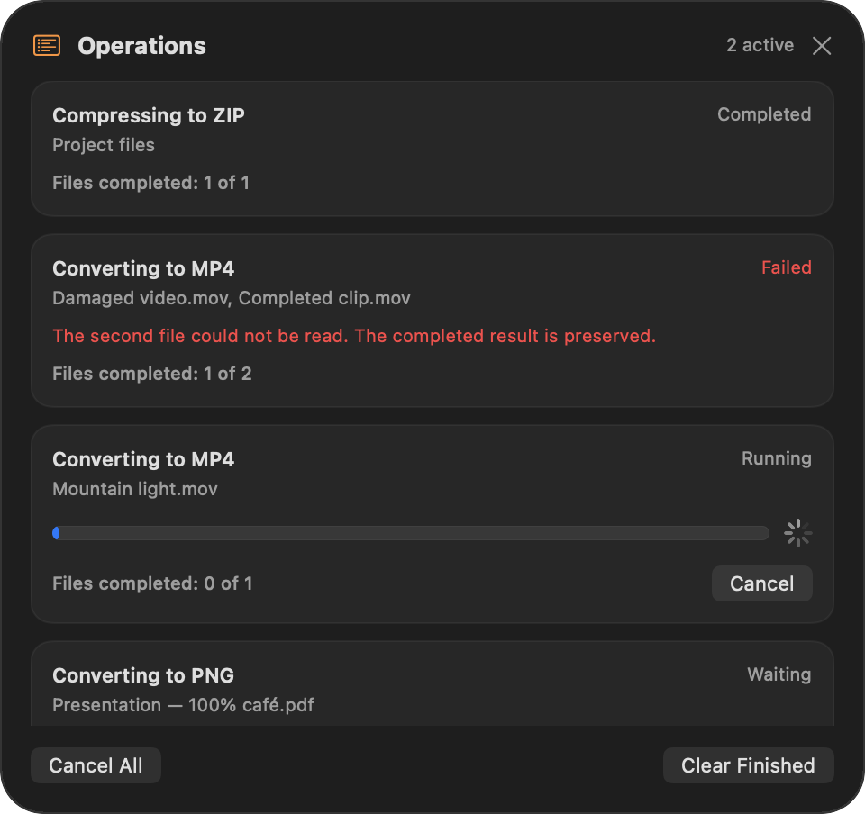

# Shelf workflow and operations

The shelf keeps references ready for dragging. Conversion and all seven Actions are available in the wheel.

1. Choose **Show Shelf**, drag files onto it, or add selected Finder files with your configured shortcut (Control+C by default).
2. Select one or more rows. Command-click or Shift-click adjusts the selection. Drag rows out of the shelf and hold **Shift** for conversion or **Control** for Actions, using your configured modifiers if changed.
3. Drop onto a wheel sector. Conversion saves beside the original after any required folder approval. Move asks for its destination; ZIP creates one archive beside the first selected input.
4. Click a row's **folder** button to select the original in Finder. The adjacent **×**, Delete, and Clear Shelf remove references without deleting files.

The shelf has no Conversion or Actions menus. Float remains in the wheel and honors the add-to-current/new-shelf preference. Other Actions include AirDrop, Copy, Move, Copy Path, Terminal, and ZIP. They retain their usual permission requirements. File tools are outside the scope. See [format support and limitations](Conversion-matrix.md).

Output files keep the original stem and use the new extension: `video.mov` → `video.mp4`. A collision uses `video_yuzu.mp4`, then `video_yuzu_2.mp4` and subsequent numbers. Existing files are never replaced. Existing long source names are preserved rather than guessed or shortened.

## Read the queue

Conversion, Move, and ZIP requests enter a serial queue and open **Operations**. Reopen it with **Show Operations**. Other Actions use their system interface directly.

| State/control | Meaning |
| --- | --- |
| Waiting | Another request runs first |
| Running | This request is processing files |
| Cancelling… | The worker is cleaning up after cancellation |
| Completed | Successful row, automatically removed after three seconds |
| Cancelled | Retained until cleared; already published results remain |
| Failed | Read the error; already published results remain |
| Cancel / Cancel All | Cancel one request, or all running/waiting requests |
| Clear Finished | Remove finished rows without deleting output files |

The window uses normal application ordering and a compact height for up to three rows, then scrolls. It has no Show Results button. Successful rows expire even while the window is hidden. When the list becomes empty after work or clearing finished rows, the window closes; errors and cancellations keep their rows until you clear them.

The count measures completed input files, not elapsed time or encoding percentage. Conversion updates between files. A spinner is shown during an individual export, Move batch, or ZIP. Move normalizes folders and children together; a later failure preserves earlier destinations. There is no rollback that deletes completed copies.

An error does not block later requests. Cancellation stops subprocesses cooperatively and discards unfinished private staging. A large filesystem copy may need time before cancellation is observed. Check remaining inputs before submitting another request; automatic retry is not included.

## Window and file lifetime

Close or Escape hides either panel without stopping work. Reopening the shelf keeps references. Removing shelf rows does not revoke grants already retained by a wheel probe, job, or system Action. Moving an original can leave a stale shelf reference; its folder button explains an unavailable path.

Shelves and remaining queue history last for the current app session. Exiting cancels outstanding jobs and waits for cleanup. Saved output profiles and files remain; queue recovery after restart is not included.

The shelf, Operations, and wheel share native Liquid Glass on macOS 26+, an earlier-system material fallback, and an opaque Reduce Transparency appearance. Solid remains available for the wheel. All app-owned labels support five languages; technical converter errors and Release Notes remain English.

These are automated fixture renders. Physical Finder/Powerbox, external-file Sandbox access, VoiceOver, macOS 13, and macOS 26 Intel appearance remain unverified. Shelf-to-wheel callback tests do not establish a full physical drag session.
