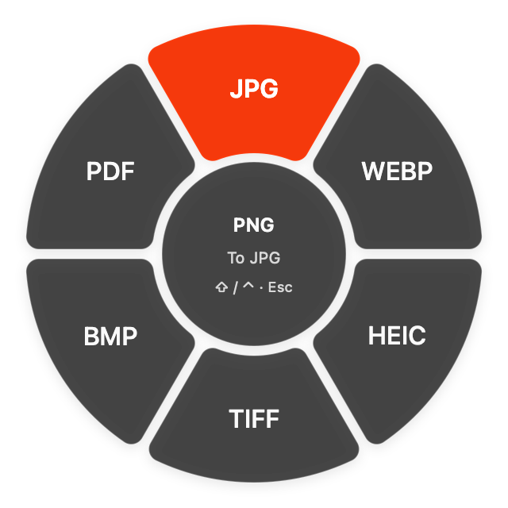

# Wheel appearance

At the owner's request, version 0.2.1 follows the wheel appearance in the owner's Yuzu Mac App project. The read-only visual reference was `Sources/YuzuUI/RadialMenuView.swift`, with its default opacity and content fade. No old conversion engines, settings, Git history, caches, or additional assets were imported. The current app keeps its existing file-drag destination, job queue, access grants, and update system.

| Element | Appearance |
| --- | --- |
| Petals | Inner/outer radii 64/144 pt, a constant 6 pt gap, 8 pt tangent corner rounding |
| Center | Separate 58 pt circle; source name/common format, current instruction, and shortcut hint |
| Ordering | First option at the top, clockwise |
| Labels | Radius 104 pt; formats use 16 pt text, Actions use 21 pt SF Symbols and 10 pt text |
| Surface | System window background at 78% opacity, separator outline, soft 8 pt shadow |
| Selection | Fixed orange sRGB (1, 0.32, 0.02), 96% opacity, white semibold label |
| Motion | 0.16 second content fade; respects the system Reduce Motion setting |

The same rounded Core Graphics path draws each petal and determines drag selection, so transparent gaps and clipped corners do not select an option. The 1% background of the armed window remains separate from the visual fade: it must receive the first AppKit drag event even while the wheel is hidden.

The center keeps the source visible while the second line changes to the selected format or a release instruction. Long source names truncate in the middle; full text remains in the tooltip/accessibility text. Existing native buttons preserve accessibility labels and help. System appearance supplies light/dark colors. The table above describes the v0.2.1 surface.

Version 0.3.0 adds Glass/Solid in [Settings](Settings.md). Glass uses a native HUD backdrop masked to the same rounded regions; the selected petal is excluded from the material so orange remains unfiltered. Solid and the system Reduce Transparency setting use an opaque surface. Geometry, label sizing, fade, armed-window input handling, and accessible buttons remain shared. The center's shortcut hint now follows the selected modifier combinations.

## Native previews

These images retain the v0.2.1 AppKit appearance with a private test pasteboard. They are not physical Finder or VoiceOver checks. Fresh Glass/Solid behavior is tested separately in the v0.3.0 Settings suite.

| Actions, light appearance | Conversion, dark appearance |
| --- | --- |
|  |  |

`WheelTests` renders both modes in both appearances to `.build/wheel-preview`, checks rounded hit regions, top-first labels, white selection, the armed window's hit-testing, and changing to a smaller option list while hovering. The localization suite checks the same keys/placeholders in all five languages. Physical drag/drop and VoiceOver checks remain tracked separately in [Validation.md](Validation.md).

## Native Liquid Glass (0.6.0)

The glass backdrop uses the same `AppSurface` factory as shelf and operations. On macOS 26+ builds with the macOS 26 SDK, it embeds `NSGlassEffectView`; older systems use `NSVisualEffectView`. A shape mask preserves the existing center and petal geometry, excluding the selected petal so orange remains unfiltered. The backdrop returns no hit-test target. Solid mode and live Reduce Transparency changes keep an opaque drawing. The glass API is availability-guarded and weak-linked; native visual parity on macOS 13 and macOS 26 Intel remains unverified.

## Feedback and shelf sources (0.6.1)

Every newly highlighted petal restarts the system Tink sound at the existing volume and requests alignment haptics when enabled. A shared 80 ms throttle no longer discards quick transitions; the drag view already filters motion within one petal. Sound replay is verified with a counting fixture; physical audible/haptic perception remains unverified. The wheel accepts file-URL dragging from Yuzu's shelf as well as other apps, while retaining original shelf batches for probes and submitted operations.
